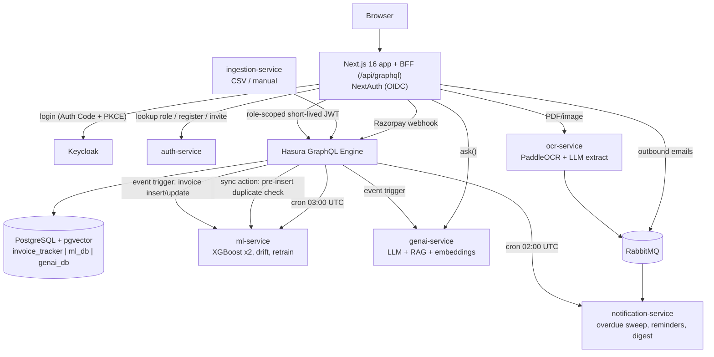

# Invoice Tracker — Project Overview (POC)

A multi-tenant **accounts payable + accounts receivable** platform with ML-based
duplicate detection, late-payment prediction, cash-flow forecasting, OCR ingestion and an
LLM/RAG "Ask" assistant. This document is the one-stop summary for a presentation:
what it does, how it works, what is built, what is not, and how it would scale.

> Status: **working POC, not deployed.** Everything runs locally via `docker compose up`.
> Kubernetes manifests and CI exist, but no cluster, domain, or TLS is provisioned.

---

## 1. Problem & value

Finance teams handle invoices through email, spreadsheets and PDFs. The pain:

| Pain | What the app does |
|---|---|
| Duplicate invoices get paid twice | ML classifier flags likely duplicates on every insert; a human confirms/clears |
| Late payments surprise cash planning | ML predicts probability + days late per invoice; cash forecast uses it |
| Manual data entry from PDFs | OCR + LLM extraction with confidence scores and a review queue |
| Chasing customers for money | Daily overdue sweep, reminders, payment links, DSO / collection stats |
| "Where do we stand with vendor X?" | Natural-language Ask panel (exact SQL-style answers + semantic search) |

---

## 2. Functional overview

### Accounts Payable (money we owe vendors)
- Capture invoices three ways: **manual form**, **CSV upload** (per-row validated preview
  before commit), **PDF/image upload** (OCR, single and bulk via a queue).
- **Approval workflow**: `pending → approved / rejected`, multi-step timeline, role-gated.
- **Payments**: record payment; status `unpaid / paid / overdue`.
- **Vendor views**: outstanding, average delay, on-time %, exposure chart, payment timeline.
- **Duplicate detection** with human review (their decisions become retraining labels).

### Accounts Receivable (money customers owe us)
- Customer master with GST details and credit limits.
- **Invoice generator**: pick a template, add line items, GST-aware (CGST+SGST vs IGST based
  on company vs customer state), company logo + saved digital signature, renders a **PDF**
  and **emails it** to the customer. Re-send supported.
- **Collection status**: `draft / sent / disputed / settled`; DSO and days-to-collect stats.
- **Razorpay payment links** and a signed webhook that auto-marks invoices paid.
- **Overdue reminders** to customers every N days until paid.

### Intelligence
- **Delay prediction** (XGBoost classifier + regressor) → green/amber/red risk dot with a
  plain-language explanation.
- **Cash forecast** — buckets 0–7 / 8–14 / 15–30 / 30+ days of predicted inflow vs outflow,
  using `due_date + predicted_delay_days`.
- **Ask panel** — hybrid router: aggregates/filters go to whitelisted database queries
  (exact); "similar to / mentions…" questions go to pgvector semantic search; an LLM
  synthesises the answer. Works offline (keyword router + templates) with no LLM key.
- **ML Ops panel (admin)** — model status, drift reports (PSI + performance), retrain
  history, manual "check drift" / "retrain" buttons; daily automatic drift check.

### Platform
- Multi-tenant (`company_id` on every business table), sign-up creates a company + admin.
- Roles: `finance_user`, `approver`, `admin` (company_admin). Invite flow + user management.
- Public landing page + "Book a demo" form (admin sees requests).
- Append-only **audit log** of auth failures and forbidden actions.

### Screens
Dashboard · Invoices (filters, bulk approve, CSV export) · Invoice detail · Create invoice ·
Upload (manual / CSV / OCR bulk / review queue) · Vendors · Customers · Receivables ·
Forecast · Vendor history · Users · Settings (company, GST, bank, logo, signature) ·
Demo requests · Ask panel (every screen) · Login / Register / Accept invite.

---

## 3. Architecture

### Components

| Component | Tech | Responsibility |
|---|---|---|
| **web** | Next.js 16, React 19, TypeScript, Tailwind, Apollo Client, Recharts, react-pdf | UI + BFF: session verification, role gates, GraphQL resolvers, PDF rendering, Razorpay routes |
| **Hasura** | GraphQL Engine v2 | Single writer to Postgres; per-role row/column permissions; event triggers, actions, cron |
| **PostgreSQL** | Postgres 16 + pgvector | System of record (31 migrations); private DBs per service |
| **auth-service** | FastAPI | Company/role/invite bookkeeping, Keycloak account provisioning, rate-limited register |
| **Keycloak** | OIDC IdP | Passwords, login page, brute-force protection |
| **ml-service** | FastAPI, XGBoost, rapidfuzz | Duplicate + delay models, drift detection, retrain, explanations |
| **genai-service** | FastAPI, sentence-transformers (MiniLM, 384-d), pgvector | Hybrid RAG Q&A, duplicate explanations, embedding indexer |
| **ocr-service** | FastAPI, PaddleOCR (CPU), pypdf | Scanned + digital PDF extraction, validation, review queue, bulk via RabbitMQ |
| **ingestion-service** | FastAPI | CSV / manual ingestion through Hasura permissions |
| **notification-service** | FastAPI | Overdue sweep, customer reminders, digest (log/Slack/SMTP), queue consumer |
| **RabbitMQ** | AMQP | Bulk OCR jobs + outbound notifications, with dead-letter queue |

### Key flows

1. **Login** — browser → Keycloak hosted page (PKCE) → BFF looks up company + role in
   auth-service → mints a Hasura-shaped session JWT. Refreshes silently ~5 min before expiry.
2. **Any read/write** — UI → `/api/graphql` → BFF verifies JWT + role → Hasura with a
   re-minted **role-scoped** JWT (Hasura's own permissions apply) → Postgres.
3. **New invoice → ML** — insert fires Hasura event trigger → ml-service scores duplicate
   probability against the same party's invoices and predicts delay → results stored in
   `ml_db`; the BFF stitches them onto invoice rows (the list still works if ml-service is down).
4. **Same insert → RAG index** — event trigger → genai-service builds an embedding
   (pgvector) asynchronously, without blocking the write.
5. **PDF upload** — page-level digital-vs-scanned detection → preprocess (deskew/denoise) →
   PaddleOCR → LLM/regex field extraction (confidence capped by OCR confidence) → validation
   (required fields, line items + tax = total). Valid → invoice; invalid → **review queue**.
6. **Generate & send invoice (AR)** — template + line items → GST calc → PDF with signature →
   invoice saved → email via RabbitMQ/notification-service (invoice is saved even if email fails).
7. **Get paid** — Razorpay payment link → signed webhook (HMAC) → payment row + status paid.
8. **Nightly** — 02:00 UTC overdue sweep + reminders; 03:00 UTC ML drift check → auto-retrain
   if drifted; retrained model hot-swapped without restart.

---

## 4. Machine learning detail

| | Duplicate detector | Delay predictor |
|---|---|---|
| Model | XGBoost classifier on **pairs** | XGBoost classifier (P(late)) + regressor (days late) |
| Features | 13 pairwise: amount/tax gap, day gap, 5 fuzzy invoice-number similarities, shared PO, department | vendor on-time rate, log(amount), approval chain length, day of month, tax fraction, PO matched, department one-hot |
| Training data | Synthetic pairs (default) or human-reviewed flags | Synthetic (default) or real paid invoices |
| Output | flag row when P(dup) > threshold (0.75 synthetic / 0.6 retrained), 60-day window | risk dot: green < 0.34 ≤ amber < 0.67 ≤ red |
| Safety | **No heuristic fallback** — 503 if model missing | same |

- One feature function shared by training and serving (no train/serve skew).
- Human confirm/clear decisions feed the next retrain (feedback loop).
- Drift: PSI on features + performance vs training-time baseline; per-company scoping.
- **Honest caveat:** default models are trained on **synthetic data**. Accuracy on real
  customer data is unproven until retrained on real history.

---

## 5. Security posture

| Area | What exists |
|---|---|
| Identity | Keycloak OIDC (Auth Code + PKCE); app never sees passwords; brute-force detection |
| Authorization | Hasura per-role row/column permissions + BFF role gate; no role can delete |
| Tenant isolation | `company_id` on all tables, enforced via JWT claims in Hasura filters |
| Least privilege | Each service mints its own scoped JWT (`ml_service`, `notifier`, `genai_readonly`, …); no admin secret in web/services (only audit-log writes still use it — known gap) |
| Service-to-service | `X-Internal-Token` on every non-health route, fails closed |
| LLM safety | LLM never writes free-form SQL; only a structured spec validated against a whitelist, run as read-only role |
| Secrets | Services refuse to boot with dev-default secrets when `ENV=production` |
| Payments | HMAC-verified Razorpay webhook (constant-time compare) |
| Data isolation | ML and GenAI data in private per-service databases |
| Audit | Append-only `audit_logs` for auth failures / forbidden actions |
| Supply chain | CI runs `npm audit` and `pip-audit` |

---

## 6. What IS there

- Full AP + AR workflows, end to end, with roles, approvals, payments, multi-tenancy.
- 7 backend services + web + Hasura + Postgres + RabbitMQ + Keycloak, one-command local stack.
- Two trained ML models, drift detection, auto-retrain, ML Ops UI.
- OCR for digital *and* scanned documents (CPU-only, no paid OCR API).
- Hybrid RAG assistant, works offline with no LLM key.
- GST-aware PDF invoice generation, email delivery, Razorpay payment links.
- 31 versioned DB migrations; Hasura metadata as code; typed GraphQL contract (codegen).
- CI: typecheck, lint, unit tests, service tests against real Postgres, Docker builds of every image, dependency audits.
- Kubernetes manifests (namespace, configmap, per-service Deployments, Keycloak, Postgres, RabbitMQ, backup CronJob, Ingress exposing only web + Keycloak).

## 7. What is NOT there (be upfront about these)

| Gap | Impact |
|---|---|
| **Not deployed** — no cluster, registry, domain, TLS; `secrets.yaml` not created | Cannot serve real users yet |
| **No monitoring / metrics / alerting** (JSON logs only, nothing aggregates them) | Blind in production |
| **No redundancy** — every component is 1 replica; no autoscaling, no multi-AZ | Single points of failure |
| **Backups unverified** — nightly `pg_dump` to a PVC, restore never tested, no offsite copy | Data-loss risk |
| **No CD pipeline** — CI builds images but doesn't push; deploys are manual `kubectl apply` | Slow / error-prone releases |
| **Payments in Razorpay test mode**; webhook not independently audited | Not ready for real money |
| **LLM is a personal Groq free-tier key** | Not sized for concurrent use; needs a paid/enterprise provider |
| **ML trained on synthetic data** | Real-world accuracy unproven |
| **No load, integration or e2e tests** — unit-level only; final Keycloak login-form callback needs a browser pass | Performance and full-journey behavior unmeasured |
| Audit-log writes still use the Hasura admin secret | Minor least-privilege gap |
| Bulk OCR/CPU inference sized for a small container (mobile PaddleOCR models) | Throughput limited; GPU or larger workers needed for volume |
| No approval-rule engine (thresholds, delegation), no ERP/accounting integrations (Tally, Zoho, SAP), no bank reconciliation, no multi-currency | Feature roadmap, not POC scope |
| No delete role by design | Corrections happen via status changes, not removal |

Items 1, 2 and 6 in the table (deployment, monitoring, live payments) are the minimum
before real users and real money.

---

## 7b. POC scope

This POC proves: the end-to-end flow works, ML/OCR/RAG can be embedded in it, security is
designed in (roles, tenancy, least privilege), and the whole thing is reproducible.
It does **not** yet prove: production performance, real-data model accuracy, operational
maturity (monitoring, DR, HA).

---

## 8. Scalability

### Where it stands today
Stateless where it matters, but every workload is deployed at **1 replica** in the manifests.

| Layer | Scales how | Bottleneck / note |
|---|---|---|
| Web/BFF (Next.js) | Stateless (JWT sessions) → horizontal replicas behind the Ingress | In-memory RabbitMQ connection per instance is fine |
| Hasura | Stateless → horizontal replicas; add read replicas for queries | Connection pool to Postgres; event triggers are at-least-once with retries |
| Postgres | Vertical first; read replicas; managed service (RDS / Cloud SQL) | Single writer; `company_id` indexes/partitioning if a tenant gets very large |
| ml-service | Stateless inference, horizontal; model loaded in memory per pod | Models are small (XGBoost) — cheap; retrain is the heavy job → move to a batch worker |
| genai-service | Horizontal; embedding model runs on CPU per pod | LLM rate limits/cost dominate; add caching, a paid provider, or self-hosted model |
| ocr-service | CPU-heavy (~1.2 GB RAM/worker); scale workers via **RabbitMQ** queue depth | Highest cost per request; GPU nodes or a cloud OCR API for volume |
| notification-service | Queue consumer → add consumers | Idempotent reminders via `last_reminder_on` |
| RabbitMQ | Clustered/quorum queues in production | Has a dead-letter queue already |
| Vector search | pgvector on the same Postgres | Fine to ~millions of chunks; move to a dedicated vector DB beyond that |
| Keycloak | Clustered with shared DB | Currently 1 replica |

### Scale path (suggested phases)
1. **Harden (pre-pilot):** deploy to a managed cluster, managed Postgres with PITR backups,
   TLS + domain, secrets manager, monitoring + alerting (Prometheus/Grafana or a hosted APM),
   test restore.
2. **Scale out (first customers):** ≥2 replicas for web/Hasura/services with HPA, PgBouncer,
   Hasura response caching, CD pipeline with staging, load-test the invoice list, OCR queue
   and Ask path; move to a paid LLM plan.
3. **Scale up (growth):** read replicas, OCR on GPU/managed API, batch retraining jobs,
   per-tenant model options, table partitioning by `company_id`/date, dedicated vector store
   if needed, ERP/accounting integrations.

### Design choices that already help scaling
- Event-driven side effects (ML scoring, embedding) are **async** — they never block writes.
- Queue-based OCR and notifications with retry + dead-letter.
- Stateless services and JWT sessions — no sticky sessions.
- Private databases per service — services can be split/scaled independently.
- Read path degrades gracefully: invoice lists still load if ml-service is down.

---

## 9. Tech stack summary

**Frontend:** Next.js 16 (App Router), React 19, TypeScript, Tailwind, Apollo Client, Recharts, @react-pdf/renderer, NextAuth v5
**API:** Hasura GraphQL + Next.js BFF (GraphQL schema is the single contract, codegen typed)
**Backend services:** Python 3.11, FastAPI
**ML / AI:** XGBoost, scikit-learn, rapidfuzz, PaddleOCR, sentence-transformers (MiniLM), pgvector, OpenAI-compatible LLM (Groq / OpenAI / Ollama / Azure OpenAI), offline fallbacks
**Data:** PostgreSQL 16 + pgvector, RabbitMQ
**Auth:** Keycloak (OIDC), HS256 Hasura JWTs
**Payments / comms:** Razorpay, SMTP / Slack
**Infra:** Docker Compose (local), Kubernetes manifests, GitHub Actions CI

---

## 10. Suggested demo script (5–7 min)

1. Log in (Keycloak) as `anjali.rao` (admin) → **Dashboard**: pending/overdue, exposure chart.
2. **Upload** a CSV (`apps/web/public/sample-invoices.csv`) → per-row validation → commit.
3. Open an invoice → **duplicate callout** + **delay-risk** panel with explanation → approve → record payment.
4. Upload a scanned PDF → OCR fields with confidence → **review queue**.
5. **Create invoice** (AR) → template, GST, signature → PDF preview → send.
6. **Forecast** page → inflow/outflow buckets.
7. **Ask panel:** "which invoices are overdue?" then "invoices that mention a penalty".
8. Admin: **ML Ops** panel → drift status, retrain history.
9. Close with slides 6–8 (what's there / not there / scale path).

Dev logins: `kavya` (finance_user), `priya.nair` / `rahul.menon` (approver), `anjali.rao` (admin).
Run: `cp infra/.env.example infra/.env && docker compose -f infra/docker-compose.yml up -d`
→ web on `localhost:3002`. Note: first build trains both ML models (~3 min).

---

## 11. Suggested slide outline

1. Problem & who it's for
2. Solution at a glance (AP + AR + AI)
3. Functional walkthrough (screens)
4. Architecture diagram (section 3)
5. Key flows (login, invoice→ML, OCR, AR→payment)
6. ML & AI (models, feedback loop, RAG, drift)
7. Security & multi-tenancy
8. What's built vs not built
9. Scalability & roadmap
10. POC results / next steps / ask
